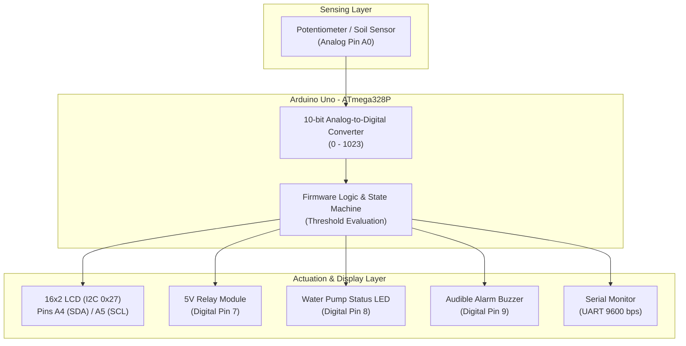

# Smart Irrigation Control System using Arduino Uno

**Course:** Computer Architecture & Microcontrollers  
**Platform:** Wokwi Embedded Systems Simulator & Arduino Hardware  
**Target Microcontroller:** ATmega328P (Arduino Uno R3)

---

## 1. Project Overview & Abstract

The **Smart Irrigation Control System** is an automated, closed-loop embedded system designed to optimize water conservation and maintain optimal soil moisture levels in agricultural or garden environments.

Traditional irrigation often relies on manual timers or visual inspection, leading to overwatering or plant dehydration. This system continuously samples the soil moisture level, classifies the soil condition into distinct states (**DRY**, **MOIST**, or **WET**), and autonomously activates or deactivates an electric water pump through an electromechanical relay. A dedicated LED provides immediate visual pump status, a 16×2 I2C Liquid Crystal Display (LCD) shows real-time moisture telemetry, an active buzzer sounds a transient warning upon detecting dry soil, and a continuous 9600-baud serial telemetry stream enables remote diagnostics.

In the **Wokwi Simulator**, an analog potentiometer simulates the analog resistive/capacitive soil moisture sensor, providing an adjustable 0–5V signal corresponding to 0%–100% moisture.

---

## 2. System Block Diagram & Architecture



---

## 3. Hardware Components & Pin Mapping

| Component | Physical Pin | Arduino Uno Pin | ATmega328P Port / Pin | Direction | Wire Color | Function / Description |
| :--- | :--- | :--- | :--- | :--- | :--- | :--- |
| **Potentiometer** | `SIG` (Wiper) | `A0` | `PC0` (ADC0) | `INPUT` | Green | Analog voltage input (0–5V) representing soil moisture |
| | `VCC` | `5V` | `VCC` | Power | Red | +5V DC supply rail |
| | `GND` | `GND.1` | `GND` | Ground | Black | Common Ground reference |
| **I2C LCD 16×2** | `SDA` | `A4` | `PC4` (SDA) | Bi-directional | Blue | I2C Serial Data line (TWI hardware) |
| | `SCL` | `A5` | `PC5` (SCL) | Output | Gold | I2C Serial Clock line (TWI hardware) |
| | `VCC` | `5V` | `VCC` | Power | Red | +5V DC supply rail |
| | `GND` | `GND.1` | `GND` | Ground | Black | Common Ground reference |
| **Relay Module** | `IN` | `D7` | `PD7` (Port D Bit 7) | `OUTPUT` | Orange | Logic control signal (Active HIGH drives pump) |
| | `VCC` | `5V` | `VCC` | Power | Red | +5V DC power for coil |
| | `GND` | `GND.2` | `GND` | Ground | Black | Common Ground reference |
| **Water Pump LED** | Anode (`+`) | `D8` via 220Ω | `PB0` (Port B Bit 0) | `OUTPUT` | Cyan | Visual indicator that water pump is operating |
| | Cathode (`-`)| `GND.2` | `GND` | Ground | Black | Common Ground reference |
| **Current Limiter** | 220Ω | In-line `D8` | — | Passive | — | Limits LED forward current to safe level (~15mA) |
| **Active Buzzer** | `1` (`-` / GND) | `GND.3` | `GND` | Ground | Black | Common Ground reference |
| | `2` (`+` / Signal) | `D9` | `PB1` (Port B Bit 1) | `OUTPUT` | Purple | 250ms transient 1 kHz audible alert upon dry detection |

### Microcontroller Architectural Register Summary (ATmega328P)
- **Port B (`DDRB` / `PORTB`)**: Digital Pin 8 (`PB0` - LED) and Digital Pin 9 (`PB1` - Buzzer)
- **Port C (`DDRC` / `PORTC` / `PINC`)**: Analog Pin A0 (`PC0` - Soil Sensor ADC), Pins A4/A5 (`PC4`/`PC5` - I2C SDA/SCL)
- **Port D (`DDRD` / `PORTD`)**: Digital Pin 7 (`PD7` - Relay Module)

---

## 4. Operational Logic & Truth Table

| Moisture Percentage | Soil Condition | Relay State | Pump LED | Buzzer Behavior | System Action |
| :---: | :---: | :---: | :---: | :---: | :--- |
| **0% – 30%** | **DRY** | **ON** (`HIGH`) | **ON** (`HIGH`) | **Short 250ms Beep** | Pump starts; alert emitted once upon state entry. |
| **31% – 70%** | **MOIST** | **OFF** (`LOW`) | **OFF** (`LOW`) | **OFF** (`LOW`) | Pump idle; soil has adequate moisture. |
| **71% – 100%** | **WET** | **OFF** (`LOW`) | **OFF** (`LOW`) | **OFF** (`LOW`) | Pump idle; soil is fully saturated/wet. |

> **Note on Buzzer Control:** Continuous buzzing creates an undesirable user experience. This firmware implements an **edge-triggered alert**: when moisture transitions from non-dry to dry, a single non-blocking 250ms chime is sounded. The system then remains quiet during irrigation until the condition reoccurs.

---

## 5. Embedded Software Architecture

1. **Initialization (`setup`)**:
   - Initializes UART Serial communication at `9600` baud.
   - Configures I/O pin directions (`INPUT` for A0; `OUTPUT` for Pins 7, 8, 9).
   - Establishes I2C connection with the PCF8574-driven LCD display at address `0x27`.
   - Displays a 2-second centered startup splash screen:
     ```text
     +----------------+
     |     SMART      |
     |   IRRIGATION   |
     +----------------+
     ```
   - Automatically transitions to the live telemetry monitoring mode.

2. **Loop Execution (`loop`)**:
   - **Analog Acquisition**: Uses `analogRead(A0)` to sample the 10-bit ADC (0 to 1023).
   - **Data Normalization**: Converts raw integer counts to a calibrated 0%–100% range using `map()` and `constrain()`.
   - **State Machine Evaluation**: Categorizes moisture into `SOIL_DRY`, `SOIL_MOIST`, or `SOIL_WET`.
   - **Actuator Modulation**: Drives Relay module (`D7`) and Pump LED (`D8`).
   - **Flicker-Free Display**: Overwrites character cells using fixed-width format buffers (`snprintf`) rather than calling `lcd.clear()`, preventing distracting display flickering.
   - **Telemetry Logging**: Emits formatted diagnostic telemetry to the Serial Monitor at 1000ms intervals using non-blocking `millis()`.

---

## 6. Serial Monitor Sample Output

```text
Moisture : 24%
Status   : DRY
Relay    : ON
LED      : ON
--------------------
Moisture : 52%
Status   : MOIST
Relay    : OFF
LED      : OFF
--------------------
Moisture : 88%
Status   : WET
Relay    : OFF
LED      : OFF
--------------------
```

---

## 7. How to Run & Deploy the Project

### Option A: Running in Wokwi Embedded Simulator

#### Method 1: In VS Code / Antigravity IDE (Recommended)
1. Install the official **Wokwi Simulator** extension in VS Code.
2. Open [`diagram.json`](file:///f:/MIT%20VishwaPrayag%20University/3%20-%20Semester/Computer%20Architecture%20&%20Microcontrollers%20-%20Project/Project%20Work/diagram.json) or [`sketch.ino`](file:///f:/MIT%20VishwaPrayag%20University/3%20-%20Semester/Computer%20Architecture%20&%20Microcontrollers%20-%20Project/Project%20Work/sketch.ino).
3. Press `F1` (or `Ctrl+Shift+P`), type **Wokwi: Start Simulator**, and hit Enter (or click the green Play button on the editor toolbar).
4. **Validation Check**: You can verify the circuit wiring anytime from the terminal by running:
   ```bash
   wokwi-cli lint
   ```

#### Method 2: In Wokwi Web (Browser)
1. Navigate to [wokwi.com/arduino/new](https://wokwi.com/arduino/new) and select **Arduino Uno**.
2. Replace `sketch.ino` with the code from [`sketch.ino`](file:///f:/MIT%20VishwaPrayag%20University/3%20-%20Semester/Computer%20Architecture%20&%20Microcontrollers%20-%20Project/Project%20Work/sketch.ino).
3. Replace `diagram.json` with the schematic from [`diagram.json`](file:///f:/MIT%20VishwaPrayag%20University/3%20-%20Semester/Computer%20Architecture%20&%20Microcontrollers%20-%20Project/Project%20Work/diagram.json).
4. In the Library Manager tab (stack of books icon), add `LiquidCrystal I2C`.
5. Press the green **Play** button to run.

### Option B: Deploying on Physical Hardware (Arduino Uno)

1. Connect your **Arduino Uno** to your computer via USB cable.
2. Launch the **Arduino IDE** (or Arduino CLI).
3. Open `sketch.ino` in the Arduino IDE.
4. Go to **Tools > Manage Libraries...** and install **LiquidCrystal I2C** (by Frank de Brabander / Marco Schwartz).
5. Select **Board: "Arduino Uno"** and choose your corresponding **COM Port** under **Tools > Port**.
6. Wire the physical components according to the pin table in Section 3.
7. Click **Upload** (or run `arduino-cli compile --upload -p COMx --fqbn arduino:avr:uno .`).
8. Open the **Serial Monitor** at **9600 baud** to observe live telemetry.

### 4. Interactive Simulation & Verification Steps:
- **Splash Screen**: Confirm the LCD displays `SMART / IRRIGATION` for 2.0 seconds upon startup.
- **Baseline MOIST State**: Observe initial state at ~50% moisture with status `MOIST`, relay `OFF`, and pump LED `OFF`.
- **Simulating Dry Soil**: Rotate the potentiometer towards 0%–30%. The LCD updates to `Status: DRY`, the relay clicks `ON`, the blue pump LED lights up, and the buzzer sounds a single crisp 250ms alert tone.
- **Simulating Optimal Soil**: Rotate the potentiometer to the middle (31%–70%). Observe LCD showing `Status: MOIST`, relay switching `OFF`, and pump LED turning `OFF`.
- **Simulating Wet Soil**: Rotate the potentiometer to high saturation (71%–100%). Observe LCD showing `Status: WET` while actuators safely remain idle.
- **Serial Diagnostics**: Monitor the continuous telemetry stream in the Serial Monitor.

---

## 8. University Viva / Demonstration Q&A

**Q1: Why did we use an I2C adapter with the 16x2 LCD instead of parallel mode?**  
*Answer:* A standard 16×2 parallel LCD requires 6 to 10 microcontroller GPIO pins (RS, EN, D4-D7, plus backlight/contrast). An I2C backpack uses a PCF8574 I/O expander, reducing microcontroller pin consumption to just 2 pins (SDA on A4, SCL on A5), freeing other pins for sensors and actuators.

**Q2: Why is a relay necessary instead of powering the water pump directly from an Arduino digital pin?**  
*Answer:* An ATmega328P digital output pin can source a maximum of 40 mA at 5V (recommended ≤ 20 mA). Real-world inductive water pumps operate on high current (typically 500mA to multiple amperes at 12V/24V/230VAC). A relay module provides electrical isolation and heavy-duty switching capacity through an electromagnetic coil.

**Q3: How is display flickering prevented during continuous updates?**  
*Answer:* Repeated calls to `lcd.clear()` wipe the internal DDRAM of the HD44780 controller, causing visible blinking. This firmware writes fixed-width padded strings directly over existing characters, updating the numbers and text seamlessly without screen clearing.

**Q4: How does the buzzer avoid continuous buzzing while soil is dry?**  
*Answer:* The firmware implements edge detection (`newState == SOIL_DRY && previousState != SOIL_DRY`) combined with a non-blocking `millis()` timer. The buzzer fires only once for 250 milliseconds when the dry threshold is first crossed.
